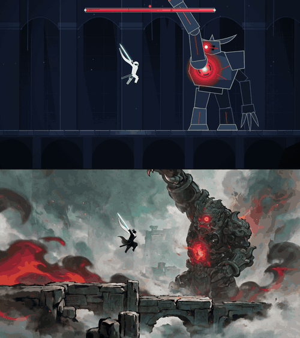
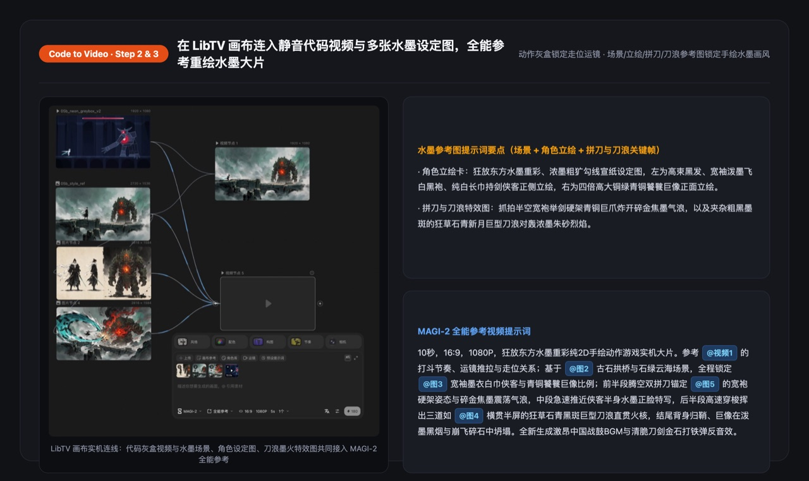

<div align="center">


# Guizang MAGI-2 Skill

**Turn a $0.05 AI video into an interactive scrollytelling website—or use code to lock every frame and hit-stop of an AI video.**

English · [简体中文](README.md)

[](SKILL.md)
[](#quick-start-30-seconds)
[](#quick-start-30-seconds)
[](#quick-start-30-seconds)
[](https://www.liblib.tv)
[](LICENSE)

<br>



*Top: A muted 2D motion greybox generated by code (tweak jump arcs, hit-stops, and camera shakes freely). Bottom: Re-rendered into a stylized ink-wash combat trailer by MAGI-2 on LibTV.*

</div>

---

Asking an AI to build a landing page from scratch usually gives you stiff CSS cards. Asking a video model to nail "a 3-frame parry freeze at 3.2s followed by an aerial slam" through text prompts alone is pure lottery.

With **MAGI-2** on **LibTV** bringing 1080P multimodal video down to pennies per clip, pairing it with a coding agent (**Antigravity**, **Claude Code**, **Codex**) unlocks two practical workflows where each side fixes the other's weakness:

1. **Video to Code**: Generate a 10s motion-graphics reference video and transparent product cutouts first, then let your coding agent build a **seamless one-take scrollytelling website** with real-time pouring fluid physics and **scroll-accelerated procedural synth music**.
2. **Code to Video**: Write deterministic code to preview exact choreography, hit-stops, and camera shakes at zero generation cost, then feed that muted greybox + 3–4 style sheets into MAGI-2 to render a **frame-accurate ink-wash, anime, or 3D trailer**.

This skill packages both workflows, battle-tested **MAGI-2 prompt optimization rules**, and a **one-command LibTV MCP fix for Antigravity** so your agent works out of the box.

---

## Quick Start (30 Seconds)

### Option 1: Paste this directly to your AI Agent (Recommended)

**For Antigravity:**
```text
Install guizang-magi2-skill for me: clone https://github.com/op7418/guizang-magi2-skill into ~/.gemini/antigravity/skills/guizang-magi2-skill and run python3 scripts/setup_libtv_antigravity.py to configure the LibTV MCP plugin.
```

**For Claude Code or Codex:**
```text
Install guizang-magi2-skill for me: clone https://github.com/op7418/guizang-magi2-skill into your skills directory and register https://mcp.liblib.tv/mcp as an HTTP MCP server named libtv.
```

### Option 2: Install from Terminal

```bash
# Via Skills CLI
npx skills add https://github.com/op7418/guizang-magi2-skill --skill guizang-magi2-skill

# Antigravity (includes one-click LibTV MCP setup & timeout fix)
git clone https://github.com/op7418/guizang-magi2-skill ~/.gemini/antigravity/skills/guizang-magi2-skill
python3 ~/.gemini/antigravity/skills/guizang-magi2-skill/scripts/setup_libtv_antigravity.py

# Claude Code
git clone https://github.com/op7418/guizang-magi2-skill ~/.claude/skills/guizang-magi2-skill
claude mcp add --transport http libtv https://mcp.liblib.tv/mcp

# Codex
git clone https://github.com/op7418/guizang-magi2-skill ~/.codex/skills/guizang-magi2-skill
codex mcp add libtv --url https://mcp.liblib.tv/mcp
```

The first time your agent calls a LibTV tool, a browser tab will open to sign in to your [LibTV](https://www.liblib.tv) account.

---

## What Can You Build With It?

| Your Goal | What Your Agent Does With This Skill |
|---|---|
| **Launch an eye-catching product landing page** | Generates a 6-grid storyboard + 10s motion reference on LibTV, bakes transparent PNGs into pop-art die-cut stickers, and codes a single-stage scrollytelling site with Canvas fluid & scroll-BPM WebAudio |
| **Create a game trailer or action short with exact timing** | Codes a 25fps motion greybox so you can tweak choreography for free, strips synthetic audio (`-an`), pairs 3–4 keyframe style sheets, and renders stylized finals via MAGI-2 |
| **Write cleaner MAGI-2 prompts on the first try** | Applies 8 empirical rules: avoids Prompt Enhance detail loss, skateboard-sliding legs, glowing eyeballs, and muddy BGM, while locking crisp moving CJK text on receipts, stamps, and UI |
| **Use LibTV MCP reliably inside Antigravity** | Fixes missing GUI `npx`/`PATH`, 60s render timeouts (`1200s`), optional proxy forwarding, and `wait_interrupted` polling so you never get double-billed |

<p align="center">
  
</p>

<p align="center">
  
</p>

---

## Example Prompts to Try Right Away

**1. Build a One-Take Product Landing Page (Video to Code)**
> Use guizang-magi2-skill to build a one-take scrollytelling landing page for a sparkling cold-brew coffee. First generate a 6-grid storyboard and a 10s pop-art transition reference video on LibTV, create transparent product/ice cutouts and turn them into die-cut stickers, then code the interactive page with pouring coffee fluid physics and electronic music whose BPM speeds up as I scroll faster.

**2. Direct a Frame-Accurate Stylized Action Trailer (Code to Video)**
> Use guizang-magi2-skill to make a 10s Chinese ink-wash 2D boss-fight trailer. First code a muted motion greybox with a jump-in, a 3-frame parry freeze, and an aerial slam for me to review. Once approved, generate the character/stage sheets on LibTV, render the ink-wash final with MAGI-2, and export a top-bottom comparison video.

**3. Write & Render a High-Precision MAGI-2 Clip**
> Use guizang-magi2-skill to write and render a 10s dark bamboo-forest wuxia swordfight on MAGI-2: lateral full-body tracking, extreme close-up, and landing slash—no sliding feet, no glowing eyes, crisp natural Foley only.

---

## Prerequisites

| Requirement | Purpose | How to Get It |
|---|---|---|
| **[LibTV](https://www.liblib.tv) Account** | Access `MAGI-2` video & `Seedream 5.5` transparent PNG generation | Sign up at `liblib.tv`; OAuth opens automatically on first MCP call |
| **Node.js 18+** | Run MCP bridge (`npx mcp-remote`) & local preview server | [nodejs.org](https://nodejs.org/) |
| **Python 3.9+** (`uv` recommended) | Run MCP installer, sticker baker, and previs sanitizer | Pre-installed on macOS; `uv` auto-fetches `pillow/numpy/scipy` |
| **`ffmpeg`** | Strip previs audio, render 12-frame check sheets, stack comparisons | `brew install ffmpeg` |

---

## What's Inside

| Path | Description |
|---|---|
| [`SKILL.md`](SKILL.md) | Main entry read by the AI agent: routing, prompt rules, MCP guardrails & workflow checklists |
| [`references/magi2-prompt-guide.md`](references/magi2-prompt-guide.md) | 8 field-tested MAGI-2 prompt rules + 4 ready-to-use templates |
| [`references/libtv-mcp-antigravity.md`](references/libtv-mcp-antigravity.md) | Antigravity LibTV MCP fix details + solutions for 4 common runtime errors |
| [`references/workflows.md`](references/workflows.md) | Step-by-step engineering guide for Video-to-Code and Code-to-Video |
| [`scripts/setup_libtv_antigravity.py`](scripts/setup_libtv_antigravity.py) | Zero-dependency installer/fixer for the LibTV MCP plugin in Antigravity |
| [`scripts/make_diecut_stickers.py`](scripts/make_diecut_stickers.py) | Bakes smooth white+black pop-art die-cut borders & splits multi-object PNG sheets |
| [`scripts/prep_code_previs.py`](scripts/prep_code_previs.py) | Strips audio (`-an`), normalizes to 25fps, renders 12-frame check sheets & top/bottom comparisons |

---

## License & Author

- **License**: [AGPL-3.0](LICENSE)
- **Author**: [Guizang (@op7418)](https://x.com/op7418) — Star the repo if you find it helpful, and feel free to share what you build!
