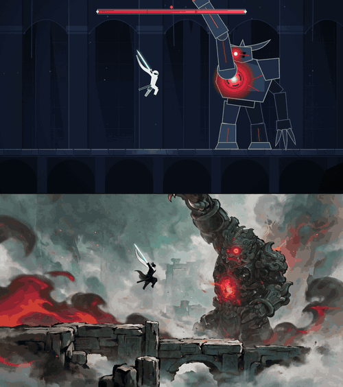
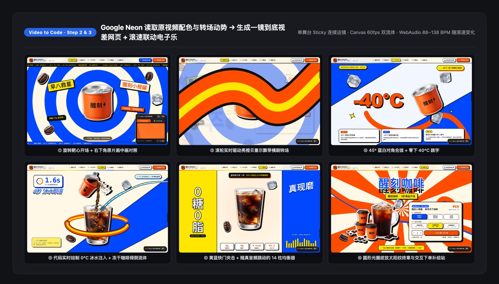
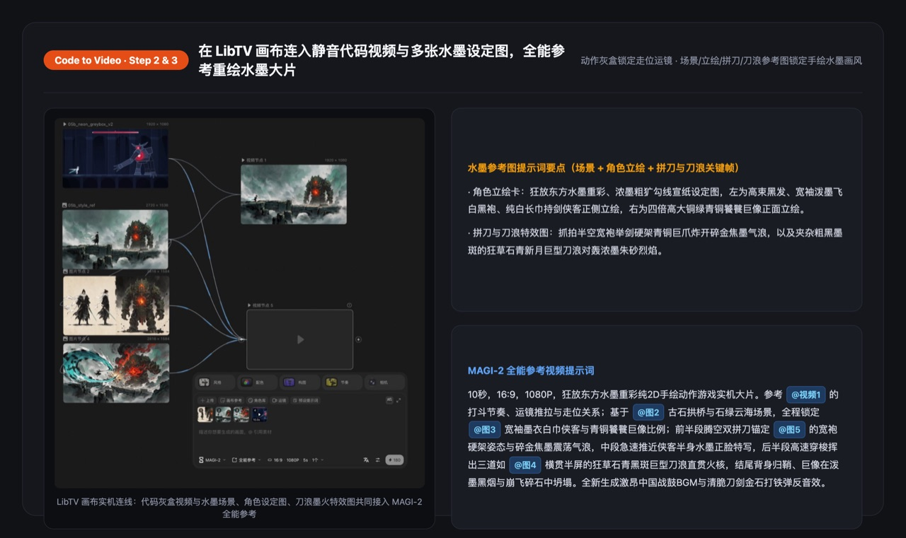

<div align="center">


# 歸藏 MAGI-2 Skill

**用几毛钱的 AI 视频帮代码做好交互官网，或者反过来用代码锁死 AI 视频的每一个动作。**

[English](README.en.md) · 简体中文

[](SKILL.md)
[](#30-秒开始)
[](#30-秒开始)
[](#30-秒开始)
[](https://www.liblib.tv)
[](LICENSE)

<br>



*上屏：让 AI 先用代码生成的静音 2D 动作灰盒（随时改代码调走位和顿帧）；下屏：交给 MAGI-2 重绘出的水墨打斗成片。*

</div>

---

平时用 AI 做网页和做视频，最头疼的往往是这两件事：

- **直接让 AI 写产品官网**，它凭空用 CSS 画出来的图形和转场大多很生硬，一股模板味。
- **直接用文字抽卡生成复杂视频**，人物容易滑步变形，想改一句“第 3 秒弹反顿一下再接特写”，重抽十次也未必对得上。

现在 LibTV 上的 **MAGI-2** 把 1080P 视频压到了 5 分钱一秒（一条 5 秒视频两毛多），提示词理解和多模态参考又很稳。把它和编程能力强的 AI 助手（Antigravity、Claude Code、Codex）连起来，两边刚好能互相补短板：

1. **Video to Code（先出视频，再转网页代码）**：花几毛钱先生成一条转场丝滑的参考视频和透明底产品贴纸，让 AI 对照着写出**一镜到底的滚动交互官网、实时倒液体动效和随滚动加速的背景音乐**。
2. **Code to Video（先写代码，再精准控视频）**：先让 AI 用代码写出动作预演视频，改代码把跳跃、弹反、镜头震屏调到分毫不差（零抽卡成本），再连同设定图喂给 MAGI-2 一次性重绘成**水墨、手绘或 3D 质感大片**。

我把跑通这两套玩法的完整流程、踩坑总结出来的 **MAGI-2 提示词优化规则**，以及 **Antigravity 版 LibTV MCP 一键修复脚本** 全部打包进了这个 Skill。装上就能直接让你的 AI 照着做。

---

## 30 秒开始

### 方式一：直接发给你的 AI 助手让它自己装（推荐）

把下面对应的一段话复制给有终端权限的 AI 助手即可：

**如果你用 Antigravity：**
```text
帮我安装 guizang-magi2-skill：请把 https://github.com/op7418/guizang-magi2-skill 克隆到 ~/.gemini/antigravity/skills/guizang-magi2-skill ，然后运行里面的 python3 scripts/setup_libtv_antigravity.py 帮我配好 LibTV MCP 插件。
```

**如果你用 Claude Code 或 Codex：**
```text
帮我安装 guizang-magi2-skill：请把 https://github.com/op7418/guizang-magi2-skill 克隆到你的 skills 目录，并把 https://mcp.liblib.tv/mcp 添加为名为 libtv 的 HTTP MCP 服务。
```

### 方式二：命令行手动安装

```bash
# 通用 Skills CLI 安装
npx skills add https://github.com/op7418/guizang-magi2-skill --skill guizang-magi2-skill

# 或者按客户端克隆：
# Antigravity（附带一键修复 LibTV MCP 连接与超时配置）
git clone https://github.com/op7418/guizang-magi2-skill ~/.gemini/antigravity/skills/guizang-magi2-skill
python3 ~/.gemini/antigravity/skills/guizang-magi2-skill/scripts/setup_libtv_antigravity.py

# Claude Code
git clone https://github.com/op7418/guizang-magi2-skill ~/.claude/skills/guizang-magi2-skill
claude mcp add --transport http libtv https://mcp.liblib.tv/mcp

# Codex
git clone https://github.com/op7418/guizang-magi2-skill ~/.codex/skills/guizang-magi2-skill
codex mcp add libtv --url https://mcp.liblib.tv/mcp
```

首次调用 LibTV 工具时会自动弹出浏览器登录你的 [LibTV](https://www.liblib.tv) 账号，点一下确认就能用。

---

## 它能帮你做什么？

| 你手里的想法 | 装上这个 Skill 后 AI 会怎么做 |
|---|---|
| **想做一个不土的新品官网 / 活动落地页** | 先在 LibTV 里生成六宫格分镜与 10 秒连续转场视频定下配色和动势；再生成透明底产品图自动切成白边波普贴纸；最后写出无接缝的一镜到底网页 |
| **想做一段动作卡点极准的游戏 PV / 动画短片** | 先写代码生成一段动作灰盒，按你的意见改好每次出招、受击顿帧和特写时机；自动剥离杂音后连同 3~4 张设定图送进 MAGI-2 重绘成最终画风 |
| **平时用 MAGI-2 生视频想少废片** | 自动套用实测总结的 8 条提示词规则：避开润色吞细节、人物踩滑板平移、眼球莫名发光、音乐音效打架，还能稳稳生成吐小票/盖印章等清晰动态中文字 |
| **在 Antigravity 里连不上 LibTV 插件或老断连** | 自带修复脚本自动搞定桌面端找不到 `npx`、长视频等待 60 秒超时断连、代理不生效等问题，并防止等待超时后重复提交导致双倍扣费 |

### 玩法一预览：Video to Code（视频转一镜到底交互官网）

<p align="center">
  
</p>

<p align="center">
  
</p>

- **视觉先定调**：不用让 AI 盲猜审美，先用几毛钱的视频把色彩和丝带/快门转场立住，网页第一版就能还原出大片感。
- **贴纸素材双向复用**：LibTV 生成的透明底产品、冰块、咖啡豆，自带脚本一键加上圆润白边与粗黑描边，直接飞进网页当交互元素。
- **代码补齐交互与声音**：冲泡环节用 Canvas 实时画出从袋口落进杯口的倾倒液体；背景电子乐直接由代码生成，**页面滚得越快，音乐 BPM 越高**。

### 玩法二预览：Code to Video（代码预演精准控制大片）

<p align="center">
  
</p>

- **改动作像改网页一样简单**：“起跳再高一点”“拼刀瞬间停顿 3 帧”“最后拉远镜头”，全在代码阶段零成本改到位。
- **自动排雷不串味**：上传前自动剥离代码灰盒里的塑料音轨、生成 12 宫格体检图排查残留几何线框，确保 MAGI-2 生成纯粹的水墨/电影质感与真实打击音效。
- **一键导出上下同屏对比**：成片出来后自动拼好“上屏代码灰盒 vs 下屏最终成片”对比视频，帧级对齐一眼可见。

---

## 怎么提需求，比较容易一次做好？

装好后不用记任何命令，直接按人话对你的 AI 说就行。下面这几段可以直接复制改词：

**1. 做一个一镜到底的新品互动官网（Video to Code）**
> 用 guizang-magi2-skill 帮我做一个气泡冷萃咖啡的一镜到底产品官网。先在 LibTV 生成六宫格分镜和 10 秒波普风连续转场视频，再生成几张透明底产品和冰块做成白边贴纸，最后照着视频动势写出滚动网页，加上倒咖啡流体动效和随滚动加速的电子乐。

**2. 做一段动作精准受控的风格化短片（Code to Video）**
> 用 guizang-magi2-skill 做一段 10 秒《雾山五行》水墨风格的 2D 横版 Boss 战短片。先用代码生成一段带跳跃、弹反顿帧和大招下劈的静音动作灰盒给我看，等我确认节奏后，再生成场景和角色设定图，在 LibTV 里重绘成水墨成片并导出上下对比视频。

**3. 只优化提示词并在 LibTV 里出一条视频**
> 用 guizang-magi2-skill 帮我写一条 10 秒的暗调竹林武侠打斗提示词并调用 MAGI-2 生成：要有高速跟拍、近景特写和落地重斩，注意别出现滑步和眼球发光，只要干净的刀剑和竹林实录音效。

**4. 做一条带清晰中文字卡的快节奏商业短片**
> 用 guizang-magi2-skill 做一条 10 秒快切咖啡店短片，里面要依次出现小票打印“破晓萃取”、牛皮纸袋盖章“灵感暴击”和屏幕点击“一杯清醒 ¥28”，保证运动时中文字清晰不抖。

---

## 适合 / 不适合

**✅ 适合用来做**
- 新品发布页、品牌故事页、带视差动画的创意落地页
- 游戏实机感宣传片、武打/动作设计预演、风格化动画短片（水墨、国漫、粘土、微缩 3D 等）
- 需要准确卡点、准确走位，或者包含清晰中文印刷字/UI 字的商业快剪视频
- 在 Antigravity / Claude Code / Codex 里把 LibTV 当成日常视觉素材工厂调用

**❌ 不适合用来做**
- 几十分钟纯人物站桩对白的长篇短剧（直接用常规剧本模式更省事）
- 表单、数据看板等纯后台管理页面
- 完全不想联网调用视频/图像生成接口的纯离线环境

---

## 需要准备什么

| 工具 | 干什么用 | 没有的话怎么补 |
|---|---|---|
| **[LibTV](https://www.liblib.tv) 账号** | 调用 `MAGI-2` 生成视频、`Seedream 5.5` 生成透明底素材 | 打开官网注册即可，首次用 MCP 会自动弹窗授权 |
| **Node.js 18+** | 运行 MCP 桥接与本地网页预览服务 | 去 [nodejs.org](https://nodejs.org/) 安装 |
| **Python 3.9+**（推荐装 `uv`） | 跑贴纸描边、灰盒预处理和 MCP 修复脚本 | macOS 自带；装 `uv` 后脚本会自动拉取所需图像处理库 |
| **`ffmpeg`** | 剥离灰盒音轨、抽帧体检、合成上下对比视频 | macOS 执行 `brew install ffmpeg` |

---

## 仓库目录（给想看细节的人）

| 路径 | 说明 |
|---|---|
| [`SKILL.md`](SKILL.md) | AI 读取的主入口：流程判断、提示词硬规则、MCP 防坑铁律与验收表 |
| [`references/magi2-prompt-guide.md`](references/magi2-prompt-guide.md) | MAGI-2 八条提示词实战规则与 4 套填空即用模板 |
| [`references/libtv-mcp-antigravity.md`](references/libtv-mcp-antigravity.md) | Antigravity 版 LibTV MCP 适配说明与 4 个常见报错解法 |
| [`references/workflows.md`](references/workflows.md) | Video to Code 与 Code to Video 的分步工程实现指南 |
| [`scripts/setup_libtv_antigravity.py`](scripts/setup_libtv_antigravity.py) | 零依赖一键安装/修复 Antigravity 上的 LibTV MCP 插件 |
| [`scripts/make_diecut_stickers.py`](scripts/make_diecut_stickers.py) | 把透明底 PNG 做成波普白边黑线贴纸（支持一张图多物体自动切分） |
| [`scripts/prep_code_previs.py`](scripts/prep_code_previs.py) | 代码灰盒一键静音、转标准帧率、出 12 宫格体检图及合成上下对比视频 |

---

## 许可与作者

- **开源协议**：[AGPL-3.0](LICENSE)
- **作者**：[歸藏](https://x.com/op7418)。如果这个 Skill 帮你的 AI 做出了好玩的网页或视频，欢迎点个 Star，也欢迎把作品发给我看！
